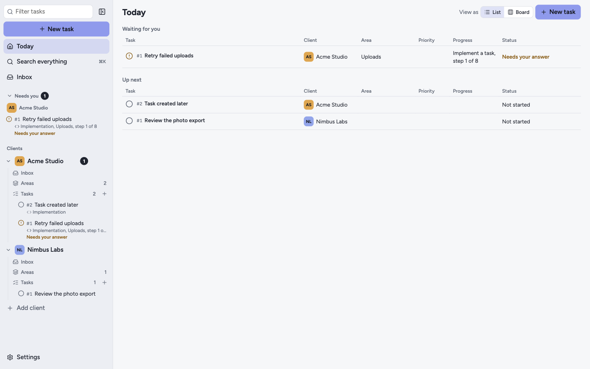

# Hatstand

**Run AI coding agents across all your clients, without mixing their context.**

Hatstand is a desktop workspace for contractors and freelancers who work for several clients at once. Each client gets its own repositories, knowledge, skills, keys, agent account and tasks. An agent working for one client sees only that client, and commit checks help keep client data out of your repositories.

[](LICENSE)
[](https://github.com/jcvargasGit/hatstand/actions/workflows/ci.yml)



> **Early version.** Hatstand runs from source, for developers. It works on macOS, and support for Linux is experimental. There are no signed builds or automatic updates yet.

## What it does

- **Today** shows what is waiting for you, what is running and in which client, and what comes next.
- **Clients** each have their own areas, repositories, knowledge, skills, keys and tasks, with a guided setup that can start from scratch.
- **Sessions** run Claude Code or GitHub Copilot CLI in a built-in terminal. An agent gets the keys and knowledge of that client only.
- **Task copies** give each task its own git worktree and branch, so tasks cannot change each other's files and your checkout stays as you left it.
- **Task guides** walk through a kind of work step by step. Hatstand writes each prompt, and you send it when you are ready.
- **Run with assistant** reads the inbox tasks you pick and proposes an order to build them, what not to run at the same time, and what needs your decision first.
- **The board** moves tasks by itself from what is true right now: the session, the commits, the pull request, CI and reviews.
- **Assigned work** comes in from Jira, GitHub and GitLab with each client's keys.
- **Commit protection** blocks commits that contain the keys or knowledge of any client.
- **Agent accounts** belong to you. Choose a personal or company account per client or per task.

## Get started

You need Git, Node.js 22, pnpm, and [Claude Code](https://claude.ai/code) or GitHub Copilot CLI signed in.

```bash
git clone https://github.com/jcvargasGit/hatstand.git
cd hatstand
pnpm install
pnpm dev
```

Linux needs a few more packages. To install it as an app on macOS, or to run it day to day on Linux, see [Getting started](docs/getting-started.md).

## Your data stays yours

- Everything about your clients stays in `~/.hatstand`, outside any repository. Hatstand refuses to start if that folder is inside a git repository.
- Keys are encrypted with your system's secret store: Keychain on macOS, and GNOME Keyring or KWallet on Linux. If there is no secret store, Hatstand refuses to save keys.
- Context reaches the agent through launch flags, so no client file is added to your repositories.
- Hatstand has no telemetry. It only talks to the services you connect, such as GitHub, GitLab and Jira, and your agents talk to their own providers.

These protections prevent accidents. **They are not a security boundary against a hostile agent**, and an agent can read the keys of its client from its environment. Read the [limits](docs/security.md#limits) before you rely on them.

## Documentation

| Guide | What it covers |
| --- | --- |
| [Getting started](docs/getting-started.md) | Install on macOS and Linux, and fix common problems |
| [User guide](docs/user-guide.md) | Clients, tasks, guides, the board, the inbox and shortcuts |
| [How Hatstand protects your data](docs/security.md) | What it protects, how, and its limits |
| [Architecture](docs/architecture.md) | How the code is organized, and how to add an agent |

## Contributing

Bug fixes, docs and tests are welcome. For a new feature, please open an issue first. Read [CONTRIBUTING.md](CONTRIBUTING.md) to set up, and [SECURITY.md](SECURITY.md) to report a security problem privately.

This project follows the [Code of Conduct](CODE_OF_CONDUCT.md).

## License

[Apache-2.0](LICENSE). See [NOTICE](NOTICE) and the [third-party licenses](THIRD_PARTY_LICENSES.md).
